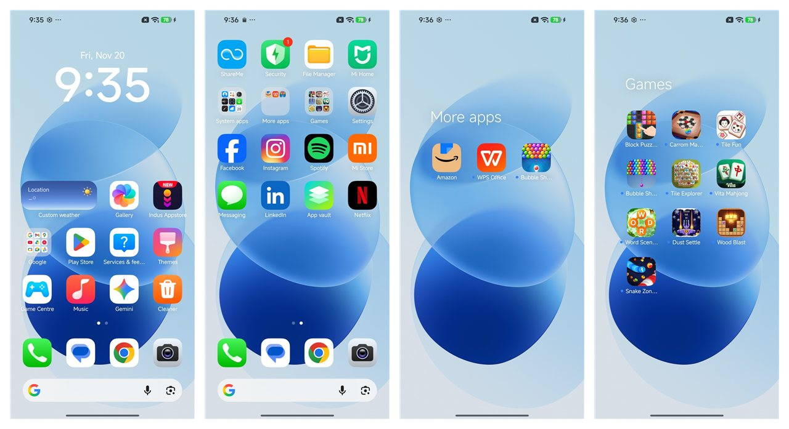
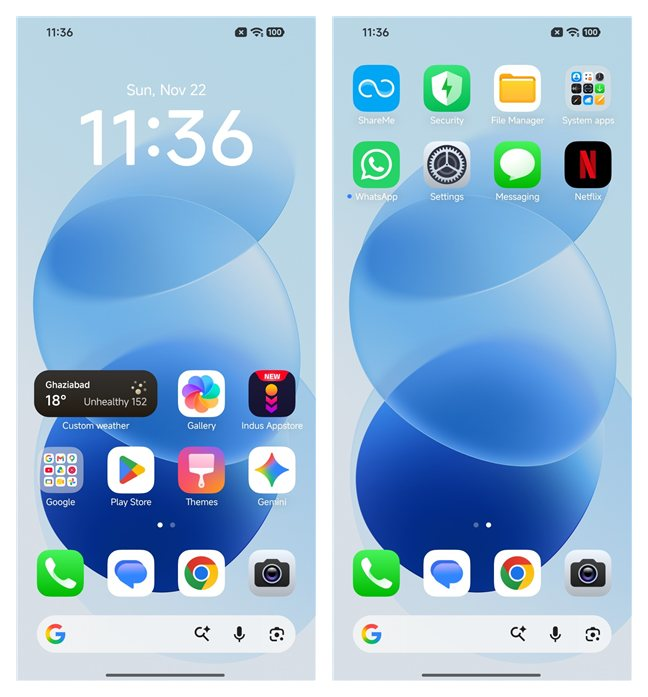

# Android Debloat Prompt

[English](README.md) | **हिन्दी**

यह एक कॉपी-पेस्ट प्रॉम्प्ट है, जो किसी भी AI असिस्टेंट (Claude, ChatGPT, Gemini वगैरह) को आपके Android फ़ोन से पहले से इंस्टॉल आए फ़ालतू ऐप्स (bloatware) हटाने वाला एक सावधान गाइड बना देता है। रूट की ज़रूरत नहीं है।

AI USB केबल से आपका फ़ोन पढ़ता है और हर ऐप को कम्युनिटी की बनाई [Universal Android Debloater Next Generation (UAD-ng)](https://github.com/Universal-Debloater-Alliance/universal-android-debloater-next-generation) लिस्ट से मिलाता है। वह आपको बताता है कि क्या हटाना सुरक्षित है, और कुछ भी बदलने से पहले **आपकी मंज़ूरी का इंतज़ार करता है**। हर ऐप हटाने से पहले वह एक undo फ़ाइल लिखता है, ताकि सब कुछ वापस लाया जा सके।

**✅ Xiaomi (Redmi), realme, vivo, Motorola और Samsung फ़ोन पर, Android 16 और 17 के साथ टेस्ट किया गया।** नतीजे नीचे देखें।

**➡️ प्रॉम्प्ट [PROMPT.md](PROMPT.md) में है।** प्रॉम्प्ट अंग्रेज़ी में है, लेकिन उसे पेस्ट करने के बाद आप AI से हिन्दी में बात कर सकते हैं।

> ⚠️ **प्रॉम्प्ट सिर्फ़ इसी पेज से कॉपी करें** (github.com/beebom-team/android-debloat-prompt)। WhatsApp, Telegram या किसी दूसरी साइट पर फ़ॉरवर्ड की गई कॉपी इस्तेमाल न करें। बदला हुआ प्रॉम्प्ट AI से गलत ऐप्स हटवा सकता है।

### जल्दी शुरू करें
1. फ़ोन का बैकअप लें और उसे 50% से ज़्यादा चार्ज करें (चरण 1)।
2. कंप्यूटर पर ADB इंस्टॉल करें (चरण 2)।
3. फ़ोन में USB debugging चालू करें और USB केबल से कंप्यूटर से जोड़ें (चरण 3)।
4. प्रॉम्प्ट को अपने AI में पेस्ट करें और उसके बताए अनुसार चलें। आप हिन्दी में बात कर सकते हैं (चरण 4)।
5. लिस्ट को मंज़ूरी दें, रीस्टार्ट के बाद फ़ोन टेस्ट करें, फिर USB debugging बंद कर दें (चरण 5–8)।

---

## यह अपने-आप क्या करता है

पहले तीन काम हर फ़ोन पर पहले से चुने रहते हैं, और आप एक ही जवाब ("go") से उन्हें मंज़ूरी देते हैं। बाकी bloatware की लिस्ट आपको दिखाई जाती है, और आप चुनते हैं कि क्या हटे:

| | क्या | कैसे |
|---|---|---|
| 🔒 | **Glance और लॉक-स्क्रीन की "स्टोरीज़" फ़ीड हटाता है**, हर ब्रांड पर: Samsung, Xiaomi, Motorola, Nothing वगैरह पर Glance; OPPO, realme और OnePlus पर Lock Screen Magazine; vivo Magazine; Wallpaper Carousel; Huawei/Honor Magazine; Tecno/Infinix की फ़ीड | इन्हें अनइंस्टॉल करता है। अगर फ़ीड लॉक स्क्रीन का ही हिस्सा है (कुछ OPPO/realme/OnePlus फ़ोन), तो उसे ब्लॉक करता है और Settings में उसे बंद करने का सही स्विच बताता है |
| 🚫 | **विज्ञापन वाले पॉप-अप रोकता है** | विज्ञापन सर्विसेज़ हटाता है (जैसे Xiaomi MSA, App Vault, AppCloud, Digital Turbine), और जिन ऐप्स को "दूसरे ऐप्स के ऊपर दिखने" की ज़रूरत नहीं, उनकी यह अनुमति बंद करता है |
| 🔕 | **Google Play के अलावा पहले से आए ऐप स्टोर्स को चुप कराता है** (Indus Appstore, GetApps, Galaxy Store, App Market, vivo App Store वगैरह) | जहाँ सुरक्षित हो, स्टोर हटा देता है। जहाँ फ़ोन को उसकी ज़रूरत है (जैसे Samsung Pay को Galaxy Store चाहिए, या जिस फ़ोन में Google Play नहीं है), वहाँ उसकी नोटिफ़िकेशन और बैकग्राउंड गतिविधि बंद कर देता है |
| 🧹 | **bloatware हटाता है**: पहले से आए ऐसे ऐप्स जिनकी आपको ज़रूरत नहीं, जैसे कंपनी के दोहरे ऐप्स (ब्राउज़र, म्यूज़िक, वीडियो, थीम्स), Facebook और दूसरे पार्टनर ऐप्स (जैसे Dailyhunt, Josh, ShareChat, Moj, Amazon, Paytm, PhonePe और लोन ऐप्स), पहले से आए गेम्स, "Games" / "Hot Apps" फ़ोल्डर में विज्ञापन भरने वाले ऐप्स, और ट्रैकर्स | हर ऐप को आसान भाषा में विवरण और जोखिम स्तर (Recommended, Advanced, Expert) के साथ दिखाता है, जो [UAD-ng](https://github.com/Universal-Debloater-Alliance/universal-android-debloater-next-generation) लिस्ट से जाँचा गया है। आप चुनते हैं कि क्या हटे, जैसे `go + all Recommended`। Expert ऐप्स सिर्फ़ बंद (disable) किए जाते हैं, कभी अनइंस्टॉल नहीं |

आखिर में AI आपको मापे गए आँकड़ों के साथ **पहले/बाद की रिपोर्ट** देता है। जिन फ़ोन पर हमने टेस्ट किया, उनके नतीजे:

| फ़ोन | ऐप्स अनइंस्टॉल / बंद | खाली हुई RAM | खाली हुई स्टोरेज |
|---|---|---|---|
| REDMI Note 17 | 76 / 0 | 468 MB | 1.6 GB |
| realme P4R | 75 / 0 | 103 MB | 3.7 GB |
| vivo T5 | 75 / 1 | 370 MB | 4.6 GB |
| moto edge 70 fusion | 5 / 48 | 420 MB | 2.0 GB |
| Samsung Galaxy M47 | 17 / 71 | 277 MB | 1.8 GB |

आपके आँकड़े अलग होंगे। वे आपके फ़ोन से आते हैं।

### पहले और बाद: REDMI Note 17

**पहले**



**बाद में**



हटाए गए: पूरा Games फ़ोल्डर (10 पहले से आए गेम्स), "More apps" फ़ोल्डर (Amazon, WPS Office, Bubble Shooter), Facebook, Instagram, Spotify, LinkedIn, Mi Store, Mi Home, App vault, Game Centre, Music, Cleaner और Services & feedback। Netflix रहा क्योंकि फ़ोन के मालिक ने उसे रखा, और WhatsApp उन्होंने खुद इंस्टॉल किया। Indus Appstore रहा, पर उसे चुप करा दिया गया।

---

## क्या यह सुरक्षित है?

इसे जितना हो सके सुरक्षित बनाया गया है, लेकिन कोई भी टूल हर फ़ोन पर काम करने की गारंटी नहीं दे सकता। शुरू करने से पहले इसे पढ़ें।

- **फ़ोन के सिस्टम से कुछ भी डिलीट नहीं होता।** ऐप्स सिर्फ़ आपकी यूज़र प्रोफ़ाइल के लिए हटाए जाते हैं (`pm uninstall --user 0`)। सिस्टम ऐप्स की इंस्टॉलेशन फ़ाइल फ़ोन में ही रहती है, इसलिए उन्हें एक कमांड से या फ़ैक्टरी रीसेट से वापस लाया जा सकता है। हटाए गए ऐप्स का डेटा और कैश डिलीट होता है; इसी से स्टोरेज खाली होती है।
- **पहले से आए कुछ ऐप्स असल में "डाउनलोड किए गए" ऐप्स होते हैं** (जैसे पार्टनर गेम्स, Xiaomi पर Mi Store या WPS Office, या vivo पर vivo Feedback)। ये पूरी तरह डिलीट हो जाते हैं, और undo फ़ाइल इन्हें वापस नहीं ला सकती; इन्हें Play Store से दोबारा इंस्टॉल करना होगा। AI लिस्ट में इन पर † का निशान लगाता है, ताकि मंज़ूरी देने से पहले आपको पता रहे।
- **आपके इस्तेमाल वाले ऐप्स "सब हटाओ" वाले विकल्प में कभी नहीं आते।** UAD-ng, WhatsApp, Netflix, Google Pay और Gmail जैसे ऐप्स को हटाने लायक मानता है। AI इन्हें अलग "Probably yours" (शायद आपके) लिस्ट में रखता है और तभी हटाता है जब आप खुद नाम लें। यही नियम **UPI और बैंकिंग ऐप्स** (Google Pay, BHIM, आपके बैंक का ऐप), **सरकारी ऐप्स** (Sanchar Saathi, DigiLocker, UMANG, mAadhaar), **मोबाइल ऑपरेटर ऐप्स** (MyJio, Airtel Thanks, Vi) और **Truecaller** पर लागू होता है, भले ही वे पहले से इंस्टॉल आए हों।
- **पहले से आए पार्टनर ऐप्स और गेम्स bloatware ही गिने जाते हैं**, जैसे Candy Crush, Block Blast, GOGO Blast, Dailyhunt, Josh, ShareChat, Moj, Facebook, Instagram, Spotify, Snapchat, LinkedIn, ChatGPT, Amazon, Flipkart, Meesho, JioHotstar, पहले से आया Paytm या PhonePe, और हर पहले से आया लोन ऐप। ये "Recommended" में होते हैं और इन पर † लगा होता है, ताकि आप जिसे इस्तेमाल करते हैं उसे छोड़ सकें।
- **हर ऐप हटाने की मंज़ूरी आप देते हैं।** AI पहले रुककर आपको लिस्ट दिखाता है।
- **undo फ़ाइल पहले लिखी जाती है।** हर बदलाव से पहले AI वापस लाने की कमांड `rollback.bat` (Windows) और `rollback.sh` (Mac/Linux) में जोड़ता है।
- **ज़रूरी ऐप्स सुरक्षित रहते हैं।** AI को कहा गया है कि डायलर, SMS ऐप, कीबोर्ड, होम स्क्रीन, Play Store, Google Play services, कैमरा, इमरजेंसी अलर्ट, सिक्योरिटी या सिस्टम अपडेट से जुड़े हिस्सों को कभी न छुए।
- **आँकड़े मापे जाते हैं, अंदाज़े से नहीं।** रिपोर्ट का हर आँकड़ा AI की चलाई किसी कमांड से आना चाहिए, वरना वह "not measured" लिखता है।
- **सिर्फ़ एक रीस्टार्ट।** AI सारे मंज़ूर बदलाव करता है, फिर आखिर में फ़ोन एक बार रीस्टार्ट करता है और आपसे कॉल, SMS, कैमरा वगैरह टेस्ट करवाता है। अगर कुछ खराब हुआ, तो वह सबसे नया ग्रुप पहले वापस करता है।

**ऑफ़िस या स्कूल का फ़ोन** (जिसे आपकी संस्था मैनेज करती है) पर इसे इस्तेमाल न करें। प्रॉम्प्ट इसे पहचानकर रुक जाता है।

---

## प्राइवेसी

- **सब कुछ आपके कंप्यूटर और फ़ोन के बीच USB केबल से होता है।** प्रॉम्प्ट खुद कुछ भी अपलोड नहीं करता।
- **आपका AI वही देखता है जो कमांड्स दिखाती हैं:** फ़ोन का ब्रांड, मॉडल, Android वर्ज़न और इंस्टॉल ऐप्स की लिस्ट। अगर आप ऑनलाइन AI इस्तेमाल करते हैं, तो यह जानकारी किसी भी चैट मैसेज की तरह उस AI कंपनी तक जाती है।
- **आपका नाम और फ़ोन का सीरियल नंबर बाहर रखे जाते हैं।** प्रॉम्प्ट AI को कहता है कि इन्हें चैट या किसी फ़ाइल में कभी न दोहराए।
- **आपके मैसेज, फ़ोटो, कॉन्टैक्ट्स और पासवर्ड कभी नहीं पढ़े जाते।** प्रॉम्प्ट सिर्फ़ वही कमांड्स चलाने देता है जो फ़ोन की बुनियादी जानकारी पढ़ें, ऐप्स की लिस्ट बनाएँ और स्टोरेज, RAM व बैटरी मापें।
- **इकलौता डाउनलोड** GitHub से UAD-ng की सार्वजनिक ऐप लिस्ट है, जब AI खुद कमांड चला सकता हो (विकल्प A)।

---

## कंप्यूटर नहीं है?

इस प्रॉम्प्ट के लिए Windows, Mac या Linux कंप्यूटर चाहिए। अगर आपके पास सिर्फ़ फ़ोन है, तो [Canta](https://github.com/samolego/Canta) एक मुफ़्त Android ऐप है जो उसी UAD-ng लिस्ट से, बिना कंप्यूटर और बिना रूट के, पहले से आए ऐप्स हटाता है। इस्तेमाल करने से पहले जान लें:
- इसके लिए पहले एक और ऐप, [Shizuku](https://shizuku.rikka.app/), सेट करना होता है।
- Canta के अपने पेज के मुताबिक Android 16 पर बदला हुआ (modified) Shizuku चाहिए, और कुछ OPPO / OnePlus ऐप्स इससे नहीं हटते।
- इसमें इस प्रॉम्प्ट जैसी जाँच, undo फ़ाइलें या पहले/बाद की रिपोर्ट नहीं है, इसलिए सिर्फ़ वही ऐप्स हटाएँ जिन्हें आप पहचानते हैं।

---

## आपको क्या चाहिए

| | |
|---|---|
| एक कंप्यूटर | Windows, macOS या Linux |
| एक USB केबल | जो डेटा ट्रांसफ़र कर सके, सिर्फ़ चार्ज नहीं |
| एक AI असिस्टेंट | कोई भी। जो खुद टर्मिनल कमांड चला सके (चरण 4 देखें), वह सबसे आसान है |
| करीब 30–60 मिनट | ज़्यादातर समय लिस्ट देखने में जाता है |

---

## चरण-दर-चरण

### चरण 1: फ़ोन का बैकअप लें
अपनी फ़ोटो और ज़रूरी डेटा का बैकअप लें, जैसे Google Photos से या कंप्यूटर पर कॉपी करके। शायद इसकी ज़रूरत न पड़े, लेकिन अगर कुछ बहुत गलत हो जाए तो आखिरी उपाय फ़ैक्टरी रीसेट ही है।

फ़ोन को 50% से ज़्यादा चार्ज करें।

### चरण 2: कंप्यूटर पर ADB इंस्टॉल करें
ADB (Android Debug Bridge) Google का आधिकारिक टूल है, जो USB से फ़ोन से बात करता है।

**Windows**, PowerShell में:
```powershell
winget install Google.PlatformTools
```
फिर PowerShell बंद करके दोबारा खोलें।

**macOS**, [Homebrew](https://brew.sh) से:
```bash
brew install --cask android-platform-tools
```

**Linux** (Debian/Ubuntu):
```bash
sudo apt install adb
```

**या सीधे Google से डाउनलोड करें:** [SDK Platform-Tools](https://developer.android.com/tools/releases/platform-tools)। इसे unzip करें और उसी फ़ोल्डर के अंदर से कमांड चलाएँ।

जाँचें कि यह काम कर रहा है:
```bash
adb version
```

### चरण 3: फ़ोन में USB debugging चालू करें
1. **Settings → About phone** खोलें।
2. **Build number** पर 7 बार टैप करें, जब तक "You are now a developer" न दिखे। कुछ फ़ोन में यह **Software information** (Samsung) या **MIUI/HyperOS version** (Xiaomi) के अंदर होता है।
3. वापस जाकर **Settings → System → Developer options** खोलें। Xiaomi, realme, OPPO और vivo पर यह आमतौर पर **Settings → Additional settings → Developer options** में होता है; Samsung पर मुख्य **Settings** लिस्ट में सबसे नीचे। न मिले तो Settings के ऊपर वाले सर्च बार में "Developer options" लिखें।
4. **USB debugging** चालू करें।
   - **Xiaomi/Redmi/POCO:** **USB debugging (Security settings)** भी चालू करें। इसके लिए SIM कार्ड और Mi अकाउंट चाहिए।
5. फ़ोन को USB केबल से कंप्यूटर से जोड़ें।
6. अगर फ़ोन पूछे "Allow USB debugging?", तो **Always allow from this computer** पर टिक करें और **Allow** दबाएँ।
7. अगर फ़ोन पूछे कि USB किस काम के लिए है, तो **File transfer** चुनें।

कनेक्शन जाँचें:
```bash
adb devices
```
आपको `device` पर खत्म होने वाली एक लाइन दिखनी चाहिए। अगर `unauthorized` लिखा हो, तो फ़ोन अनलॉक करके **Allow** दबाएँ।

### चरण 4: प्रॉम्प्ट अपने AI को दें

**विकल्प A: ऐसा AI जो खुद कमांड चला सके (सबसे आसान)।** जैसे [Claude Code](https://claude.com/claude-code) और Claude डेस्कटॉप ऐप का Code टैब, OpenAI Codex CLI, और Gemini CLI।
1. एक नया खाली फ़ोल्डर बनाएँ, जैसे `phone-debloat`, और AI को वहीं खोलें। AI अपनी लिस्ट और undo फ़ाइलें इसी फ़ोल्डर में रखेगा।
2. [PROMPT.md](PROMPT.md) खोलें, ग्रे बॉक्स के अंदर का सब कुछ कॉपी करें, और AI में पेस्ट करें।
3. AI खुद कमांड्स चलाता है और जो मिला वह आपको दिखाता है।

**विकल्प B: चैट वाला AI** (वेब पर ChatGPT, Claude.ai, Gemini)।
1. प्रॉम्प्ट चैट में पेस्ट करें।
2. AI आपको एक बार में एक कमांड देगा। हर कमांड टर्मिनल में चलाएँ (Windows पर PowerShell, Mac पर Terminal), **हर बार उसी फ़ोल्डर के अंदर**, और उसका आउटपुट वापस AI में पेस्ट करें।
3. जब AI undo फ़ाइलों का कंटेंट दिखाए, तो उन्हें उसी फ़ोल्डर में उन्हीं नामों से सेव करें (`rollback.bat`, `rollback.sh`)।

चैट वाला AI आमतौर पर UAD-ng लिस्ट डाउनलोड नहीं कर पाता। वह आपको यह बताएगा और अपनी रेटिंग पर "AI knowledge, unverified" लिखेगा। ऐसी रेटिंग के साथ ज़्यादा सावधान रहें, या विकल्प A इस्तेमाल करें।

**आपकी भाषा:** प्रॉम्प्ट पेस्ट करने के बाद आप AI को हिन्दी, तमिल, तेलुगु, बांग्ला, मराठी या किसी भी भाषा में लिख सकते हैं, और वह उसी भाषा में जवाब देगा। कमांड्स और ऐप्स के नाम अंग्रेज़ी में ही रहेंगे।

### चरण 5: लिस्ट ध्यान से देखें
AI पहले फ़ोन को मापता है ("पहले" के आँकड़े), बिना रीस्टार्ट किए। फिर आपको दिखाता है:

| ग्रुप | मतलब | चुना हुआ? |
|---|---|---|
| **Group A** | Glance, लॉक-स्क्रीन फ़ीड, विज्ञापन सर्विसेज़, पॉप-अप, ऐप स्टोर की परेशानियाँ | ✅ पहले से चुना हुआ |
| **Recommended** | बाकी bloatware जो लगभग सभी के लिए सुरक्षित है | आप चुनें |
| **Advanced** | ऐसे फ़ीचर जो कुछ लोग इस्तेमाल करते हैं | आप चुनें; हर एक पढ़ें |
| **Expert** | चीज़ें बिगाड़ सकते हैं; सिर्फ़ बंद किए जाते हैं, अनइंस्टॉल कभी नहीं | तभी चुनें जब पक्का पता हो कि ज़रूरत नहीं |

जवाब में साफ़ लिखें कि क्या लागू करना है, जैसे:
- `go` सिर्फ़ Group A लागू करता है
- `go, except A3 and A7` Group A लागू करता है, उन दो को छोड़कर
- `go + all Recommended`
- `go + Recommended except 4 and 9`

आप पूरी हेडिंग भी मंज़ूर कर सकते हैं, जैसे `go + Recommended, Tracking and logs`। हर ऐप एक छोटी लाइन में उसके आम नाम और आप क्या खोएँगे, के साथ दिखता है। तकनीकी पैकेज नाम `review.md` में सेव रहते हैं।

AI ऐसा कुछ नहीं बदलेगा जिसकी आपने मंज़ूरी नहीं दी।

बदलाव करते समय AI बीच में कुछ नहीं पूछता। अगर फ़ोन कोई ऐप हटाने से मना करे, तो AI उसे नोट करके आगे बढ़ता है; मना किया गया ऐप स्टोर अपने-आप चुप करा दिया जाता है। सब हो जाने पर वह एक छोटा सार दिखाता है और **एक बार** पूछता है कि मना किए गए ऐप्स को बंद (disable) कर दें या नहीं।

### चरण 6: रीस्टार्ट के बाद टेस्ट करें
सारे बदलाव होने के बाद AI फ़ोन को एक बार रीस्टार्ट करता है। फ़ोन अनलॉक करें, फिर जाँचें:

- [ ] अनलॉक काम करता है (PIN, फ़िंगरप्रिंट, फ़ेस)
- [ ] लॉक स्क्रीन पर सामान्य वॉलपेपर है, कोई स्टोरी या विज्ञापन नहीं
- [ ] कॉल करें और रिसीव करें
- [ ] SMS भेजें और रिसीव करें
- [ ] मोबाइल डेटा और Wi-Fi
- [ ] Bluetooth
- [ ] कैमरा (फ़ोटो और वीडियो)
- [ ] किसी मैसेजिंग ऐप की नोटिफ़िकेशन
- [ ] Play Store खुलता है और ऐप अपडेट करता है
- [ ] अलार्म
- [ ] बैंकिंग या पेमेंट ऐप्स खुलते हैं (अगर कोई कहे कि Developer options चालू है, तो यह उसकी अपनी सुरक्षा जाँच है, कोई खराबी नहीं; चरण 8 के बाद वह फिर खुलेगा)
- [ ] Settings → System update खुलता है

AI को नतीजा बताएँ। अगर कुछ खराब हुआ, तो वह सबसे नया ग्रुप पहले वापस करता है (हर बार एक और रीस्टार्ट) और पता लगाता है कि कौन सा ऐप ज़िम्मेदार था।

### चरण 7: अपनी रिपोर्ट पढ़ें
सब ठीक चलने पर AI फ़ोन को फिर मापता है (बिना एक और रीस्टार्ट के) और आपको `report.md` देता है, जिसमें होता है:
- **ऐप्स:** पहले और बाद में कितने इंस्टॉल थे (पहले से आए और डाउनलोड किए अलग-अलग)
- **खाली हुई स्टोरेज:** फ़ोन पर मापी गई, और हटाए गए ऐप्स के साइज़ से अनुमान
- **खाली हुई RAM:** हटाए गए ऐप्स जितनी RAM इस्तेमाल कर रहे थे, और पूरे फ़ोन का पहले/बाद का बदलाव (इस नोट के साथ कि उसका कुछ हिस्सा रीस्टार्ट की वजह से है)
- **Glance और हर ऐप स्टोर के साथ क्या हुआ,** और जो सिर्फ़ ब्लॉक हो सका उसे कैसे बंद करें
- **विज्ञापन के वे स्विच जो आपको खुद बंद करने होंगे:** कुछ विज्ञापन ऐसे ऐप्स से आते हैं जिन्हें रहना ही है, जैसे Xiaomi के Security और Themes ऐप, या realme के "Hot Apps" फ़ोल्डर। रिपोर्ट Settings में सही स्विच बताती है

खाली हुई स्टोरेज अक्सर उम्मीद से कम होती है। पहले से आए ऐप्स फ़ोन के read-only हिस्से में रहते हैं, इसलिए सिर्फ़ उनके अपडेट, डेटा और कैश ही खाली होते हैं। रिपोर्ट यह समझाती है।

आखिर में AI पूछता है **"Do you want to remove any more apps?"** (क्या और ऐप्स हटाने हैं?) और बताता है कि और क्या हट सकता है। जो हटाना हो उसका नाम लें, और वह undo लाइनों, एक रीस्टार्ट और उन्हीं जाँचों के साथ एक और सावधान राउंड करेगा। या "no" कहें, और काम पूरा।

### चरण 8: USB debugging बंद करें
**Settings → Developer options** में जाकर सबसे ऊपर वाला स्विच बंद करें। यह ज़्यादा सुरक्षित है, और कई बैंकिंग व UPI ऐप्स Developer options चालू रहने पर नहीं खुलते। आपकी undo फ़ाइलें बाद में भी काम करेंगी; बस पहले USB debugging फिर से चालू कर लें।

---

## वापस कैसे लाएँ (Undo)

**सब कुछ वापस लाने के लिए:** USB debugging चालू करके फ़ोन जोड़ें, undo फ़ाइलों वाले फ़ोल्डर में टर्मिनल खोलें, और चलाएँ:

- **Windows (PowerShell):** `.\rollback.bat` (Command Prompt में सिर्फ़ `rollback.bat`)
- **macOS / Linux:** `sh rollback.sh`

**एक ऐप वापस लाने के लिए:**
```bash
adb shell cmd package install-existing --user 0 com.example.package
```
Android 7 या पुराने पर:
```bash
adb shell pm install-existing --user 0 com.example.package
```
अगर ऐप अनइंस्टॉल की जगह बंद (disable) किया गया था:
```bash
adb shell pm enable --user 0 com.example.package
```
अगर किसी ऐप स्टोर को चुप कराया गया था, या किसी ऐप के पॉप-अप बंद किए गए थे, तो वापस लाने की सही लाइनें (पुरानी सेटिंग के साथ) undo फ़ाइलों में हैं।

**आखिरी उपाय:** फ़ैक्टरी रीसेट हर हटाया गया ऐप वापस लाता है, लेकिन आपका डेटा मिटा देता है।

---

## AI कौन सी फ़ाइलें बनाता है

| फ़ाइल | क्या है |
|---|---|
| `report.md` | पहले/बाद की आखिरी रिपोर्ट |
| `review.md` | AI की सुझाई पूरी लिस्ट, तकनीकी पैकेज नामों के साथ |
| `packages_before*.txt` / `packages_after*.txt` | पहले और बाद की ऐप लिस्ट |
| `rollback.bat` / `rollback.sh` | हर बदलाव की undo कमांड्स |
| `removal_log.csv` | क्या बदला, कब, और काम किया या नहीं |
| `meminfo_before.txt` / `meminfo_after.txt` | RAM की रीडिंग, हर ऐप कितनी इस्तेमाल कर रहा था |
| `uptime_before.txt` / `uptime_after.txt` | हर रीडिंग के समय फ़ोन कितनी देर से चालू था |
| `df_before.txt` / `df_after.txt` | स्टोरेज की रीडिंग |
| `diskstats_before.txt` | हटाने से पहले हर ऐप का साइज़ (कुछ फ़ोन, जैसे HyperOS 3 और realme UI 7, यहाँ सिर्फ़ कुल आँकड़े रखते हैं) |
| `battery_before.txt` | बैटरी लेवल और तापमान |

यह फ़ोल्डर संभालकर रखें। आपकी undo फ़ाइलें इसी में हैं।

---

## दिक्कतें और हल

| दिक्कत | हल |
|---|---|
| `adb` is not recognized | इंस्टॉल के बाद टर्मिनल दोबारा खोलें, या platform-tools फ़ोल्डर के अंदर से कमांड चलाएँ (वहाँ PowerShell में `adb` की जगह `.\adb` लिखें) |
| `adb devices` कुछ नहीं दिखाता | दूसरी केबल आज़माएँ (कई केबल सिर्फ़ चार्ज करती हैं), **File transfer** मोड चुनें, USB debugging बंद-चालू करें, फिर `adb kill-server` चलाएँ |
| `unauthorized` | फ़ोन अनलॉक करें और **Allow** दबाएँ। पूछ ही नहीं रहा? **Developer options → Revoke USB debugging authorizations** दबाएँ, फिर दोबारा जोड़ें |
| Xiaomi पर `Failure [DELETE_FAILED_USER_RESTRICTED]` | Developer options में **USB debugging (Security settings)** चालू करें |
| `Failure [not installed for 0]` | ऐप पहले ही हट चुका है। कुछ करने की ज़रूरत नहीं |
| Xiaomi HyperOS पर `Failure [-1000]` | HyperOS, Xiaomi के कुछ अपने ऐप्स को बचाता है (जैसे ShareMe, Scanner, Compass, Weather, Notes, Calculator, Screen Recorder)। ऐप जैसा था वैसा रहता है। कुछ खराब नहीं हुआ |
| OPPO / realme / OnePlus पर `Failure [DELETE_FAILED_INTERNAL_ERROR]` | फ़ोन अपने कुछ ऐप्स को बचाता है (जैसे App Market, Game Center, Instant Games)। कुछ खराब नहीं हुआ। ऐप स्टोर हो तो AI उसे अपने-आप चुप करा देता है। vivo भी `DELETE_FAILED_USER_RESTRICTED` से मना कर सकता है; उसे भी ऐसे ही संभाला जाता है |
| vivo / iQOO (OriginOS) पर कई ऐप्स मना हो जाते हैं | एक टेस्ट किए गए OriginOS 6 फ़ोन पर vivo के 15 अपने ऐप्स मना हुए (जैसे V-Appstore, Jovi, vivoCloud)। कुछ खराब नहीं हुआ। AI उन्हें बंद करने का विकल्प देता है |
| `Failure [only root can delete system app for a particular user]` (Android 17) | Android 17 वाले टेस्ट किए गए Motorola edge 70 fusion और Samsung Galaxy M47 पर हर पहले से आया ऐप ऐसे ही मना हुआ। कुछ खराब नहीं हुआ। AI उन्हें बंद करने का विकल्प देता है। बंद ऐप्स न चल सकते हैं, न विज्ञापन दिखा सकते हैं, न नोटिफ़िकेशन भेज सकते हैं; RAM वापस मिलती है, स्टोरेज नहीं |
| `Failure: package is non-disable` | फ़ोन इस ऐप को हटाने या बंद करने से बचाता है। कुछ खराब नहीं हुआ। अगर यह नोटिफ़िकेशन भेजे, तो उस पर देर तक दबाकर उन्हें बंद करें |
| `Shell cannot change component state for null to 3` | ऐप शुरू करने से पहले ही बंद था। कुछ करने की ज़रूरत नहीं |
| फ़ोन पर दिखने वाले नाम से AI ऐप नहीं ढूँढ पा रहा | कुछ पहले से आए ऐप्स के पैकेज नाम अजीब होते हैं। AI बाकी ऐप्स हटाकर अंदाज़ा लगाता है और आपसे पक्का करवाता है। खुद देखने के लिए: **Settings → Apps → (ऐप) → App details** से उसका Play Store पेज खुलता है, जिसके पते में पैकेज नाम होता है |
| ऐप स्टोर चुप कराने के बाद भी नोटिफ़िकेशन भेज रहा है | Android 13 और नए पर फ़ोन नोटिफ़िकेशन ब्लॉक तुरंत वापस कर सकता है। हाथ से बंद करें: **Settings → Apps → (स्टोर) → Notifications** |
| बैंक या UPI ऐप नहीं खुल रहा और Developer options, USB debugging या "unsafe device" की बात कर रहा है | यह ऐप की अपनी सुरक्षा जाँच है, debloat से हुई खराबी नहीं। Developer options बंद करें (चरण 8) और ऐप फिर खोलें |
| चैट AI कहता है कि प्रॉम्प्ट बहुत लंबा है | [PROMPT.md](PROMPT.md) डाउनलोड करें (फ़ाइल के ऊपर दाईं ओर डाउनलोड बटन) और पेस्ट करने की जगह फ़ाइल चैट में अटैच करें |
| PowerShell में `rollback.bat` is not recognized | `.\rollback.bat` लिखें (PowerShell मौजूदा फ़ोल्डर की फ़ाइल तभी चलाता है जब आगे `.\` हो) |
| फ़ोन के अपने ऐप्स (Security, Themes, File Manager) में अब भी विज्ञापन आते हैं | इन ऐप्स को रहना ही है, इसलिए इनके विज्ञापन सिर्फ़ Settings से बंद होते हैं। आपकी रिपोर्ट में सही स्विच लिखे हैं। न मिले तो Settings में "recommendations" सर्च करें |
| हर ऐप इंस्टॉल करने के बाद विज्ञापन या "recommended apps" वाला पेज आता है (OPPO, realme, OnePlus, vivo, iQOO, Xiaomi) | OPPO / realme / OnePlus पर यह पेज App Market से आता है। रीस्टार्ट के बाद AI App Market की settings खोलकर आपके लिए **"Security test for apps not from App Market"** (इससे विज्ञापन वाला पेज बंद होता है) और **"Hot apps & hot games"** बंद कर देता है, फिर होम स्क्रीन से विज्ञापन वाले **"Apps"** और **"Games"** टाइल हटा देता है (स्विच बंद करने से पहले से बने टाइल नहीं हटते)। अगर वह न कर पाए (जैसे फ़ोन अंग्रेज़ी में न हो), तो वह आपसे यह करने को कहेगा: App Market → Settings में इन्हें बंद करें, फिर हर टाइल पर देर तक दबाकर **Remove** चुनें। vivo / iQOO पर यह i Manager से आता है, जिसे रहना ही है: उसकी settings में इंस्टॉल के समय की security check और recommendations बंद करें। Xiaomi पर: **Security → Settings → Receive recommendations** बंद करें |
| होम स्क्रीन पर "Games", "Hot Apps" या "Hot Games" फ़ोल्डर ऐसे ऐप्स से भरा है जो इंस्टॉल ही नहीं हैं (जैसे Motorola, vivo या realme पर) | ये शॉर्टकट हैं जो टैप करने पर ऐप डाउनलोड करते हैं। प्रॉम्प्ट उन्हें डालने वाले ऐप्स हटा देता है, ताकि नए न आएँ। Motorola पर "Games" फ़ोल्डर ("Game picks", "Play without downloading") Moto Smart Feed से आता है, जिसे अब प्रॉम्प्ट बंद कर देता है। उसके recommendations वाले पॉप-अप पर "Agree and continue" न दबाएँ। फ़ोल्डर सिर्फ़ आइकन है: उस पर देर तक दबाएँ और **Remove** चुनें। vivo / iQOO पर V-Appstore की settings में "Hot apps and games on home screen" भी बंद करें |
| सिस्टम अपडेट के बाद कोई ऐप वापस आ गया | यह सामान्य है। बड़े अपडेट के बाद प्रक्रिया फिर से चलाएँ |
| रीस्टार्ट के बाद फ़ोन लोगो पर अटक गया | अगर `adb devices` अब भी फ़ोन दिखाता है, तो undo फ़ाइल चलाएँ। वरना recovery mode से फ़ैक्टरी रीसेट करें |

---

## अक्सर पूछे जाने वाले सवाल

**क्या इससे मेरा फ़ोन तेज़ हो जाएगा?**
आमतौर पर इससे स्पीड से ज़्यादा प्राइवेसी, स्टोरेज और बैटरी में फ़ायदा होता है, और लॉक-स्क्रीन विज्ञापन व परेशान करने वाली नोटिफ़िकेशन हट जाती हैं। नए फ़ोन पर स्पीड में फ़र्क अक्सर कम होता है। रिपोर्ट मापे गए आँकड़े दिखाती है, ताकि आप खुद देख सकें।

**Glance वापस आ गया, या लॉक स्क्रीन पर अब भी स्टोरीज़ आ रही हैं। क्यों?**
कुछ फ़ोन में फ़ीड लॉक स्क्रीन का ही हिस्सा होती है और सुरक्षित तरीके से हटाई नहीं जा सकती, इसलिए AI उसे ब्लॉक करता है और Settings का स्विच बताता है। Android 17 वाले एक टेस्ट किए गए Motorola फ़ोन पर Glance सिर्फ़ बंद हो सका, और रीस्टार्ट के बाद अपने-आप फिर चालू हो गया। AI रीस्टार्ट के बाद इसे जाँचता है और फिर बंद करता है। Settings में खुद बंद करना सबसे पक्का है। बड़ा सिस्टम अपडेट भी Glance वापस ला सकता है।

**मेरे Samsung पर Glance ऐप नहीं मिल रहा, फिर भी लॉक स्क्रीन पर Glance दिखता है।**
Samsung पर Glance का अपना कोई ऐप नहीं है। यह Samsung की "Wallpaper services" (`com.samsung.android.dynamiclock`) से आता है, जो **Settings → Lock screen → Wallpaper services** में दिखती है। प्रॉम्प्ट हर Samsung फ़ोन पर इस पैकेज को Glance मानता है। Wallpaper services में **None** भी चुन लें, तो यह बंद रहता है।

**Galaxy Store (या मेरे फ़ोन का ऐप स्टोर) क्यों नहीं हटा?**
कुछ स्टोर फ़ोन के लिए ज़रूरी होते हैं। Samsung Pay को Galaxy Store चाहिए, और जिन फ़ोन में Google Play नहीं है, वहाँ ब्रांड का स्टोर ही ऐप इंस्टॉल करने का इकलौता तरीका है। ऐसे में AI स्टोर की नोटिफ़िकेशन और बैकग्राउंड गतिविधि बंद कर देता है।

**क्या यह Google Pay, मेरा बैंक ऐप या Sanchar Saathi हटा देगा?**
नहीं, जब तक आप खुद नाम न लें। बैंकिंग, सरकारी और मोबाइल ऑपरेटर ऐप्स, और Google Pay व BHIM जैसे UPI ऐप्स हमेशा "Probably yours" लिस्ट में रहते हैं, भले ही पहले से इंस्टॉल आए हों। पहले से आया Paytm या PhonePe और लोन ऐप्स bloatware माने जाते हैं और "Recommended" में आते हैं। अगर आप Paytm या PhonePe इस्तेमाल करते हैं तो उसे छोड़ दें: दोबारा इंस्टॉल करने पर फिर से साइन इन करना पड़ता है।

**क्या इसके लिए रूट चाहिए, या इससे वारंटी खत्म होगी?**
रूट की ज़रूरत नहीं है, और bootloader अनलॉक नहीं होता। सिर्फ़ सामान्य ADB कमांड्स इस्तेमाल होती हैं।

**क्या इसे वापस किया जा सकता है?**
ज़्यादातर हाँ। सिस्टम ऐप्स सिर्फ़ आपकी यूज़र प्रोफ़ाइल से हटते हैं, और undo फ़ाइलें उन्हें वापस लाती हैं। लिस्ट में † वाले ऐप्स (पहले से आए "डाउनलोड किए गए" ऐप्स, जैसे पार्टनर गेम्स) पूरी तरह डिलीट होते हैं; उन्हें Play Store से दोबारा इंस्टॉल करें।

**यह किन फ़ोन पर काम करता है?**
किसी भी ब्रांड के Android 5 और नए फ़ोन पर। Android 17 पर फ़ोन बिना रूट के पहले से आए ऐप्स अनइंस्टॉल करने से मना कर सकता है (Motorola edge 70 fusion और Samsung Galaxy M47 पर देखा गया), तब ऐप्स बंद किए जाते हैं और स्टोरेज कम या बिल्कुल खाली नहीं होती।

---

## अपने फ़ोन की रिपोर्ट भेजें

आज़माया? हमें बताएँ कि कैसा रहा, खासकर अगर आपका ब्रांड या मॉडल नतीजों की टेबल में नहीं है। हर रिपोर्ट से प्रॉम्प्ट और फ़ोन संभाल पाता है।

**[➡️ अपने फ़ोन की रिपोर्ट भेजें](https://github.com/beebom-team/android-debloat-prompt/issues/new?template=phone-report.yml)** (मुफ़्त GitHub अकाउंट चाहिए)। फ़ोन मॉडल, Android वर्ज़न, किस चरण में दिक्कत आई (अगर आई), और अपनी `report.md` की पहले/बाद वाली टेबल डालें। अपना नाम, फ़ोन नंबर या फ़ोन का सीरियल नंबर न डालें।

---

## श्रेय

[Beebom](https://beebom.com) के [Ramjie Wassane](https://x.com/ramjie) ने बनाया।

ऐप रेटिंग [Universal Android Debloater Next Generation](https://github.com/Universal-Debloater-Alliance/universal-android-debloater-next-generation) कम्युनिटी लिस्ट से आती है। अगर आप AI की जगह बटन वाला डेस्कटॉप ऐप चाहते हैं, तो सीधे UAD-ng इस्तेमाल करें।

अपने जोखिम पर इस्तेमाल करें। सिस्टम ऐप्स हटाने के ऐसे असर हो सकते हैं जिनका किसी को अंदाज़ा न हो, इसलिए मंज़ूरी देने से पहले हर लिस्ट ध्यान से देखें। अगर अंग्रेज़ी और हिन्दी पेज में कोई फ़र्क हो, तो [अंग्रेज़ी पेज](README.md) मान्य है।
