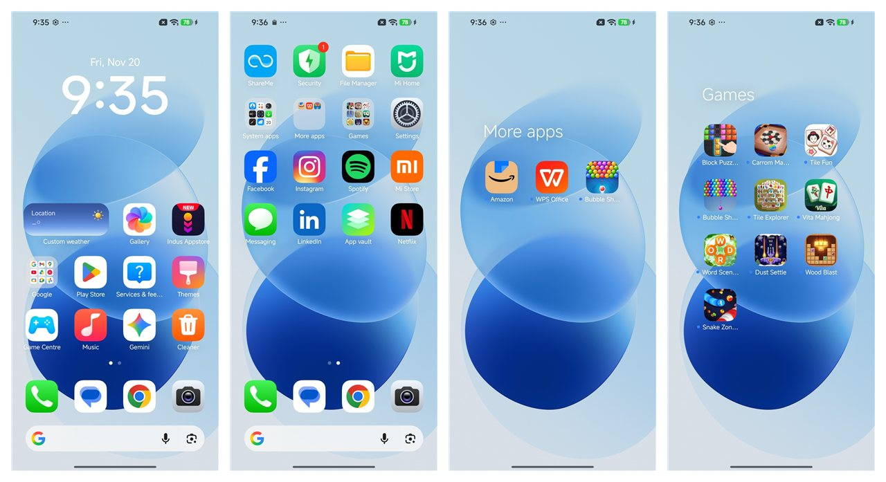
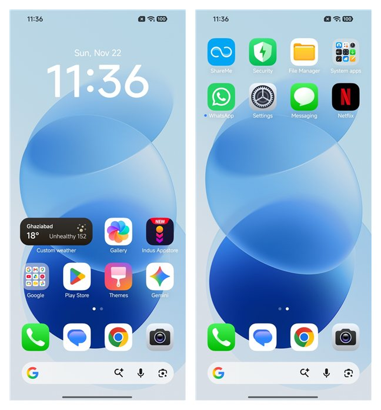

# Android Debloat Prompt

**English** | [हिन्दी](README.hi.md)

A copy-paste prompt that turns any AI assistant (Claude, ChatGPT, Gemini, and others) into a careful guide for removing preinstalled bloatware from an Android phone. No root needed.

The AI reads your phone over a USB cable and checks every app against the community-maintained [Universal Android Debloater Next Generation](https://github.com/Universal-Debloater-Alliance/universal-android-debloater-next-generation) list. It shows you what is safe to remove and **waits for your approval** before changing anything. It writes an undo file before each removal, so everything can be put back.

**✅ Tested on Xiaomi (Redmi), realme, vivo, Motorola, Samsung and OPPO phones, on Android 16 and 17.** [See the results](#what-it-does-by-default).

**➡️ The prompt is in [PROMPT.md](PROMPT.md).**

> ⚠️ **Copy the prompt only from this page** (github.com/beebom-team/android-debloat-prompt). Don't use copies forwarded on WhatsApp, Telegram or other sites. A changed prompt could make the AI remove the wrong apps.

### Quick start
1. Back up your phone and charge it above 50% ([Step 1](#step-1-back-up-your-phone)).
2. Install ADB on your computer ([Step 2](#step-2-install-adb-on-your-computer)).
3. Turn on USB debugging and connect the phone with a USB cable ([Step 3](#step-3-turn-on-usb-debugging-on-the-phone)).
4. Paste the prompt into your AI and follow along. You can chat in Hindi or any other language ([Step 4](#step-4-give-the-prompt-to-your-ai)).
5. Approve the list, test the phone after the restart, then turn off USB debugging ([Steps 5–8](#step-5-review-the-list-carefully)).

---

## What it does by default

The first three are pre-selected on every phone, and you confirm them once with a single reply ("go"). Bloatware removal is shown as a list for you to pick from:

| | What | How |
|---|---|---|
| 🔒 | **Removes Glance and lock-screen "stories" feeds** on every brand: Glance on Samsung, Xiaomi, Motorola, Nothing and others; Lock Screen Magazine on OPPO, realme and OnePlus; vivo Magazine; Wallpaper Carousel; Huawei/Honor Magazine; Tecno/Infinix feeds | Uninstalls them. If the feed is built into the lock screen itself (some OPPO/realme/OnePlus phones), it blocks the feed instead and shows you the exact switch to turn it off in Settings |
| 🚫 | **Stops ad pop-ups** | Removes ad services (for example Xiaomi MSA, App Vault, AppCloud, Digital Turbine), and blocks "display over other apps" for apps that shouldn't have it |
| 🔕 | **Silences preinstalled app stores** that aren't Google Play (Indus Appstore, GetApps, Galaxy Store, App Market, vivo App Store and others) | Removes the store where it's safe to. Where the phone needs it (for example Samsung Pay needs Galaxy Store, or a phone without Google Play), it turns off the store's notifications and background activity instead |
| 🧹 | **Removes bloatware**: preinstalled apps you don't need, such as duplicate OEM apps (browser, music, video, themes), Facebook and other partner apps (for example Dailyhunt, Josh, ShareChat, Moj, Amazon, Paytm, PhonePe and preloaded loan apps), preinstalled games, the apps that fill "Games" / "Hot Apps" folders with ads, and trackers | Lists every one with a plain-English description and a risk level (Recommended, Advanced, Expert), checked against the [UAD-ng](https://github.com/Universal-Debloater-Alliance/universal-android-debloater-next-generation) community list. You pick what goes, for example `go + all Recommended`. Expert apps are only disabled, never uninstalled |

At the end, the AI gives you a **before/after report** with measured numbers. Results from the phones we tested:

| Phone | Apps uninstalled / disabled | RAM freed | Storage freed |
|---|---|---|---|
| REDMI Note 17 | 76 / 0 | 468 MB | 1.6 GB |
| realme P4R | 75 / 0 | 103 MB | 3.7 GB |
| vivo T5 | 75 / 1 | 370 MB | 4.6 GB |
| moto edge 70 fusion | 5 / 48 | 420 MB | 2.0 GB |
| Samsung Galaxy M47 | 17 / 71 | 277 MB | 1.8 GB |
| OPPO K14 5G | 22 / 29 | 276 MB | 2.4 GB |

Your numbers will differ. They come from your phone.

### Before and after: REDMI Note 17

**Before**



**After**



Gone: the whole Games folder (10 preinstalled games), the "More apps" folder (Amazon, WPS Office, Bubble Shooter), Facebook, Instagram, Spotify, LinkedIn, Mi Store, Mi Home, App vault, Game Centre, Music, Cleaner and Services & feedback. Netflix stayed because the owner kept it, and WhatsApp was installed by the owner. Indus Appstore stayed but was muted.

---

## Is this safe?

It is designed to be as safe as possible, but no tool can promise it works on every phone. Read this before you start.

- **Nothing is deleted from the phone's system.** Apps are removed only for your user profile (`pm uninstall --user 0`). For apps that are part of the system, the installation file stays on the phone, so they can be restored with one command or by a factory reset. The removed apps' own data and cache are deleted; that's what frees storage.
- **Some preinstalled apps are really "downloaded" apps** (for example partner games, Mi Store or WPS Office on Xiaomi, or vivo Feedback, which lives in `/system/custom/app` on vivo phones). These are deleted completely, and the undo file can't bring them back; you reinstall them from the Play Store. The AI marks them with † in the list so you know before you approve.
- **Apps you probably use are never in a "remove all" choice.** UAD-ng rates apps like WhatsApp, Netflix, Google Pay and Gmail as removable. The AI puts them in a separate "Probably yours" list and removes one only if you name it. The same goes for **UPI and banking apps** (Google Pay, BHIM, your bank's app), **government apps** (Sanchar Saathi, DigiLocker, UMANG, mAadhaar), **operator apps** (MyJio, Airtel Thanks, Vi) and **Truecaller**, even when they came preinstalled.
- **Preinstalled partner apps and games do count as bloatware**, for example Candy Crush, Block Blast, GOGO Blast, Dailyhunt, Josh, ShareChat, Moj, Facebook, Instagram, Spotify, Snapchat, LinkedIn, ChatGPT, Amazon, Flipkart, Meesho, JioHotstar, a preinstalled Paytm or PhonePe, and every preloaded loan app. They are in "Recommended" and marked †, so you can leave out any you use.
- **You approve every removal.** The AI stops and shows you a table first.
- **An undo file is written first.** Before each removal, the AI adds the restore command to `rollback.bat` (Windows) and `rollback.sh` (Mac/Linux).
- **Important apps are protected.** The AI is told never to touch your dialer, SMS app, keyboard, home screen, Play Store, Google Play services, camera, emergency alerts, security, or system update components.
- **Numbers are measured, not guessed.** The AI must take every number in the report from a command it ran, or say "not measured".
- **Only one restart.** The AI applies everything you approved, then restarts the phone once at the end and asks you to test calls, SMS, camera and other basics. If something broke, it undoes the newest group first.

**Do not use this on a work or school phone** that your organisation manages. The prompt detects this and stops.

---

## Privacy

- **Everything happens between your computer and your phone,** over the USB cable. The prompt doesn't upload anything by itself.
- **The AI you use sees what the commands show:** your phone's brand, model, Android version and its list of installed apps. If you use an online AI, this goes to that AI company like any other chat message.
- **Your name and your phone's serial number are kept out.** The prompt tells the AI never to repeat them in the chat or in any file it writes.
- **Your messages, photos, contacts and passwords are never read.** The prompt only allows commands that read basic phone details, list apps, and measure storage, RAM and battery.
- **The only download** is the public UAD-ng app list from GitHub, when the AI can run commands itself (Option A).

---

## No computer?

This prompt needs a Windows, Mac or Linux computer. If you only have a phone, [Canta](https://github.com/samolego/Canta) is a free Android app that removes preinstalled apps without a computer or root, using the same UAD-ng list. Before you try it, know that:
- It needs another app, [Shizuku](https://shizuku.rikka.app/), set up first.
- Canta's own page says Android 16 needs a modified Shizuku, and some OPPO / OnePlus apps can't be removed with it.
- It doesn't do this prompt's checks, undo files or before/after report, so remove only apps you recognise.

---

## What you need

| | |
|---|---|
| A computer | Windows, macOS or Linux |
| A USB cable | One that can transfer data, not just charge |
| An AI assistant | Any. One that can run terminal commands (see Step 4) is the easiest |
| About 30–60 minutes | Most of it is reviewing the list |

---

## Step-by-step

### Step 1: Back up your phone
Back up your photos and important data, for example with Google Photos or by copying them to your computer. You probably won't need it, but a factory reset is the last-resort fix if something goes badly wrong.

Charge the phone above 50%.

### Step 2: Install ADB on your computer
ADB (Android Debug Bridge) is Google's official tool for talking to a phone over USB.

**Windows**, in PowerShell:
```powershell
winget install Google.PlatformTools
```
Then close and reopen PowerShell.

**macOS**, with [Homebrew](https://brew.sh):
```bash
brew install --cask android-platform-tools
```

**Linux** (Debian/Ubuntu):
```bash
sudo apt install adb
```

**Or download it directly** from Google: [SDK Platform-Tools](https://developer.android.com/tools/releases/platform-tools). Unzip it and run commands from inside that folder.

Check that it works:
```bash
adb version
```

### Step 3: Turn on USB debugging on the phone
1. Open **Settings → About phone**.
2. Tap **Build number** 7 times until it says "You are now a developer". On some phones it's under **Software information** (Samsung) or **MIUI/HyperOS version** (Xiaomi).
3. Go back to **Settings → System → Developer options**. On Xiaomi, realme, OPPO and vivo it's usually **Settings → Additional settings → Developer options**; on Samsung it's at the bottom of the main **Settings** list. If you can't find it, type "Developer options" in the search bar at the top of Settings.
4. Turn on **USB debugging**.
   - **Xiaomi/Redmi/POCO:** also turn on **USB debugging (Security settings)**. This needs a SIM card and a Mi account.
5. Connect the phone to your computer with the USB cable.
6. If the phone asks "Allow USB debugging?", tick **Always allow from this computer** and tap **Allow**.
7. If the phone asks what the USB connection is for, choose **File transfer**.

Check the connection:
```bash
adb devices
```
You should see one line ending in `device`. If it says `unauthorized`, unlock the phone and tap **Allow**.

### Step 4: Give the prompt to your AI

**Option A: an AI that can run commands (easiest).** Examples are [Claude Code](https://claude.com/claude-code) and the Claude desktop app's Code tab, OpenAI Codex CLI, and Gemini CLI.
1. Make a new empty folder, for example `phone-debloat`, and open the AI there. The AI will save its lists and undo files in this folder.
2. Open [PROMPT.md](PROMPT.md), copy everything inside the grey box, and paste it into the AI.
3. The AI runs the commands itself and shows you what it found.

**Option B: a chat AI** (ChatGPT, Claude.ai, Gemini on the web).
1. Paste the prompt into the chat.
2. The AI gives you one command at a time. Run each one in a terminal (PowerShell on Windows, Terminal on Mac) **inside the same folder every time**, and paste the output back to the AI.
3. When the AI shows you the contents of the undo files, save them in that folder with the exact names it gives (`rollback.bat`, `rollback.sh`).

A chat AI usually can't download the UAD-ng list. It will tell you so, and mark its ratings as "AI knowledge, unverified". Be more cautious with those, or use Option A.

**Your language:** after pasting the prompt, you can write to the AI in Hindi, Tamil, Telugu, Bengali, Marathi or any other language, and it will reply in that language. Commands and app names stay in English.

### Step 5: Review the list carefully
The AI measures the phone first (the "before" numbers), without restarting it. Then it shows you:

| Group | What it means | Selected? |
|---|---|---|
| **Group A** | Glance, lock-screen feeds, ad services, pop-ups, app-store nags | ✅ Pre-selected |
| **Recommended** | Other bloatware that's safe for almost everyone | You choose |
| **Advanced** | Features some people use | You choose; read each one |
| **Expert** | Can break things; only disabled, never uninstalled | Skip unless you know you don't need it |

Reply with exactly what to apply, for example:
- `go` applies Group A only
- `go, except A3 and A7` applies Group A without those two items
- `go + all Recommended`
- `go + Recommended except 4 and 9`

You can also approve a whole heading, for example `go + Recommended, Tracking and logs`. Each app is shown as one short line with its everyday name and what you'd lose. The technical package names are saved in `review.md` if you want to look them up.

The AI will not change anything you didn't approve.

While the AI applies your changes, it doesn't stop to ask you anything. If the phone refuses to remove an app, the AI logs it and keeps going; a refused app store is muted automatically. When everything has been tried, it shows a short summary and asks you **once** whether to disable the refused apps instead.

### Step 6: Test after the restart
When every approved change is done, the AI restarts the phone once. Unlock it, then check:

- [ ] Unlock works (PIN, fingerprint, face)
- [ ] The lock screen shows a normal wallpaper, with no stories or ads
- [ ] Make and receive a call
- [ ] Send and receive an SMS
- [ ] Mobile data and Wi-Fi
- [ ] Bluetooth
- [ ] Camera (photo and video)
- [ ] Notifications from a messaging app
- [ ] Play Store opens and updates an app
- [ ] Alarms
- [ ] Banking or payment apps open (if one complains that Developer options is on, that's its own security check, not a problem; it opens again after [Step 8](#step-8-turn-off-usb-debugging))
- [ ] Settings → System update opens

Tell the AI the result. If something broke, it undoes the newest group first (one extra restart each time) and narrows down which app caused it.

### Step 7: Read your report
When everything works, the AI measures the phone again (no extra restart) and gives you `report.md` with:
- **Apps:** how many were installed before and after (preinstalled and downloaded counted separately)
- **Storage freed:** measured on the phone, plus an estimate from the removed apps' sizes
- **RAM freed:** the RAM the removed apps were using, plus the whole-phone before/after change (with a note that part of that change comes from the restart)
- **What happened to Glance and each app store,** and how to turn off anything that could only be blocked
- **Ad switches you must turn off yourself:** some ads come from apps that have to stay, such as Xiaomi's Security and Themes apps or realme's "Hot Apps" folders. The report gives you the exact switches in Settings

Storage freed is often smaller than people expect. Preinstalled apps live on a read-only part of the phone, so only their updates, data and cache can be freed. The report explains this.

Finally, the AI asks **"Do you want to remove any more apps?"** and shows what's still possible (the tiers you skipped, and the "Probably yours" list). Name what you want removed, and it does another careful round with its own undo lines, one restart and the same checks. Or say no, and you're done.

### Step 8: Turn off USB debugging
Go to **Settings → Developer options** and turn off the switch at the top. This is safer, and many banking and UPI apps won't open while Developer options is on. Your undo files still work later; just turn USB debugging on again first.

---

## How to undo

**Undo everything:** connect the phone with USB debugging on, open a terminal in the folder with the undo files, and run:

- **Windows (PowerShell):** `.\rollback.bat` (in Command Prompt, just `rollback.bat`)
- **macOS / Linux:** `sh rollback.sh`

**Undo one app:**
```bash
adb shell cmd package install-existing --user 0 com.example.package
```
On Android 7 or older:
```bash
adb shell pm install-existing --user 0 com.example.package
```
If an app was disabled instead of uninstalled:
```bash
adb shell pm enable --user 0 com.example.package
```
If an app store was muted, or an app's pop-ups were blocked, the exact restore lines (with the original settings) are in the undo files.

**Last resort:** a factory reset brings back every removed app, but it erases your data.

---

## Files the AI creates

| File | What it is |
|---|---|
| `report.md` | The final before/after report |
| `review.md` | The full list the AI suggested, with technical package names |
| `packages_before*.txt` / `packages_after*.txt` | App lists before and after (all, preinstalled, downloaded, disabled) |
| `rollback.bat` / `rollback.sh` | Undo commands for every change |
| `removal_log.csv` | What was changed, when, and whether it worked |
| `meminfo_before.txt` / `meminfo_after.txt` | RAM readings, including how much each app was using |
| `uptime_before.txt` / `uptime_after.txt` | How long the phone had been on at each reading |
| `df_before.txt` / `df_after.txt` | Storage readings |
| `diskstats_before.txt` | Size of each app before removal (some phones, such as HyperOS 3 and realme UI 7, only record totals here) |
| `battery_before.txt` | Battery level and temperature |

Keep the folder. Your undo files are in it.

---

## Troubleshooting

| Problem | Fix |
|---|---|
| `adb` is not recognized | Reopen the terminal after installing, or run commands from inside the platform-tools folder (in PowerShell, type `.\adb` instead of `adb` there). If you unzipped it to `C:\platform-tools`, an AI that runs commands finds it there and uses the full path |
| `adb devices` shows nothing | Use a different cable (many cables are charge-only), choose **File transfer** mode, toggle USB debugging off and on, then run `adb kill-server` |
| `unauthorized` | Unlock the phone and tap **Allow** on the prompt. No prompt? Turn on **Developer options → Revoke USB debugging authorizations**, then reconnect |
| `Failure [DELETE_FAILED_USER_RESTRICTED]` on Xiaomi | Turn on **USB debugging (Security settings)** in Developer options |
| `Failure [not installed for 0]` | The app is already removed. Nothing to do |
| `Failure [-1000]` on Xiaomi HyperOS | HyperOS protects some of Xiaomi's own apps (for example ShareMe, Scanner, Compass, Weather, Notes, Calculator, Screen Recorder). The app stays as it was. Nothing broke |
| `Failure [DELETE_FAILED_INTERNAL_ERROR]` on OPPO / realme / OnePlus | The phone protects some of its own apps (for example App Market, Game Center, Instant Games). The app stays as it was. Nothing broke. For an app store, the AI automatically mutes it instead. vivo can also refuse with `DELETE_FAILED_USER_RESTRICTED`; it's handled the same way |
| Many vivo / iQOO apps are refused (OriginOS) | On a tested OriginOS 6 phone, 15 of vivo's own apps were refused (for example V-Appstore, Jovi, vivoCloud, App Clone, Floating ball, Smart Vision). Nothing broke. The AI offers to disable them instead; the vivo Lock Screen Poster could be disabled this way |
| `Failure [only root can delete system app for a particular user]` (Android 17) | On a tested Motorola edge 70 fusion and a Samsung Galaxy M47, both with Android 17, every preinstalled app was refused this way. Nothing broke. The AI offers to disable them instead. Disabled apps can't run, show ads or send notifications, so you get the RAM back but not the storage |
| `Failure: package is non-disable` | The phone protects this app from being removed or disabled (tested on Motorola). Nothing broke. If it sends notifications, long-press one and turn them off |
| `Shell cannot change component state for null to 3` | The app was already disabled before you started. Nothing to do |
| The AI can't find an app by the name shown on the phone | Some preinstalled apps use random-looking package names (on a tested vivo phone, "Axe Ace" and "EVO" were `com.kncbetru.weryu` and `com.lgzddt.sk.yfv.opcyzl.bitjiz`). The AI narrows it down by elimination and asks you to confirm. To check yourself: **Settings → Apps → (the app) → App details** opens its Play Store page, and the address contains the package name |
| An app store still sends notifications after it was muted | On Android 13 and newer, the phone can undo the notification block right away. Turn it off by hand: **Settings → Apps → (the store) → Notifications** |
| My bank or UPI app won't open and mentions Developer options, USB debugging or an "unsafe device" | That's the app's own security check, not damage from debloating. Turn off Developer options ([Step 8](#step-8-turn-off-usb-debugging)) and open the app again |
| The chat AI says the prompt is too long | Download [PROMPT.md](PROMPT.md) (the download button at the top right of the file) and attach the file to the chat instead of pasting it |
| `rollback.bat` is not recognized in PowerShell | Type `.\rollback.bat` (PowerShell only runs files from the current folder with `.\` in front) |
| Ads still appear inside the phone's own apps (Security, Themes, File Manager) | These apps must stay, so their ads can only be turned off in Settings. Your report lists the exact switches. Search Settings for "recommendations" if you can't find one |
| An ad or "recommended apps" page appears every time you install an app (OPPO, realme, OnePlus, vivo, iQOO, Xiaomi) | On OPPO / realme / OnePlus the page comes from App Market. After the restart, the AI opens App Market's settings and turns off **"Security test for apps not from App Market"** (this stops the ad page) and **"Hot apps & hot games"** for you, then removes the sponsored **"Apps"** and **"Games"** tiles from your home screen (turning the switch off doesn't remove the ones already there). If it can't (for example, your phone isn't in English), it asks you to do it: switch them off in App Market → Settings, then long-press each tile and choose **Remove**. On vivo / iQOO it comes from i Manager, which must stay: in its settings, turn off the security check on installation and recommendations. On Xiaomi: **Security → Settings → Receive recommendations** off |
| A "Games", "Hot Apps" or "Hot Games" folder on the home screen is full of apps that aren't installed (for example on Motorola, vivo or realme) | Those are shortcuts that download an app when tapped. The prompt removes the apps that put them there, so no new ones appear. On Motorola, the "Games" folder ("Game picks", "Play without downloading") comes from Moto Smart Feed, which the prompt now switches off. Don't tap "Agree and continue" on its recommendations pop-up. The folder itself is only icons: long-press it and choose **Remove**. On vivo / iQOO, the AI turns off **"Create Apps on the home screen"** and **"Create Games on the home screen"** in V-Appstore's settings, which removes the "Apps" and "Games" tiles. On OPPO / realme / OnePlus it removes the tiles itself |
| A preinstalled app store (V-Appstore, App Market, GetApps, Galaxy Store, Indus Appstore) keeps sending notifications | Every store that stays on the phone gets its notification permission revoked and locked, so it can't send notifications or ask again (tested on vivo with Android 16). If one still does, turn it off in **Settings → Apps → (the store) → Notifications** |
| An app came back after a system update | Normal. Run the process again after big updates |
| The phone is stuck on the logo after a restart | If `adb devices` still shows it, run the undo file. Otherwise, factory reset from recovery mode |

---

## FAQ

**Will this make my phone faster?**
It usually helps privacy, storage and battery more than speed, and it removes lock-screen ads and nagging notifications. On a newer phone the difference in speed is often small. The report shows measured before/after numbers so you can see for yourself.

**Glance came back, or my lock screen still shows stories. Why?**
On some phones the feed is built into the lock screen and can't be removed safely, so the AI blocks it and gives you the Settings switch to turn it off. On a tested Motorola phone with Android 17, Glance could only be disabled, and it turned itself back on after the restart. The AI checks for this after the restart, disables it once more, and gives you the Settings switch. Turning it off in Settings yourself sticks best. A big system update can also reinstall Glance. Run the prompt again after updates.

**I can't find a Glance app on my Samsung, but the lock screen still shows Glance.**
On Samsung, Glance has no app of its own. It comes from Samsung's "Wallpaper services" (`com.samsung.android.dynamiclock`), and you can see it under **Settings → Lock screen → Wallpaper services**. The prompt now treats that package as Glance on every Samsung phone. On a tested Galaxy M47 with Android 17 it could only be disabled, not uninstalled, and it stayed off after the restart. Choosing **None** in Wallpaper services as well keeps it off.

**Why wasn't Galaxy Store (or my phone's app store) removed?**
Some stores are needed by the phone. Samsung Pay needs Galaxy Store, and on phones without Google Play the brand's store is the only way to install apps. In those cases the AI turns off the store's notifications and background activity instead, which stops the nagging.

**Will it remove Google Pay, my bank app or Sanchar Saathi?**
No, not unless you name the app yourself. Banking, government and mobile-operator apps, and UPI apps such as Google Pay and BHIM, always go in the "Probably yours" list, even when they came preinstalled. A preinstalled Paytm or PhonePe and preloaded loan apps are treated as bloatware and listed under "Recommended". Leave Paytm or PhonePe out if you use it: after reinstalling it you have to sign in again.

**Does it need root, or does it void my warranty?**
No root is needed, and it doesn't unlock the bootloader. It uses only standard ADB commands.

**Is it reversible?**
Mostly. System apps are removed for your user profile only, and the undo files restore them. Apps marked † in the list (preinstalled "downloaded" apps such as partner games) are deleted completely; you reinstall those from the Play Store if you want them back.

**Which phones does it work on?**
Android 5 and newer from any brand. On Android 17, the phone may refuse to uninstall any preinstalled app without root (seen on a Motorola edge 70 fusion and a Samsung Galaxy M47), so apps are disabled instead and little or no storage is freed. The prompt detects Samsung One UI, Xiaomi MIUI/HyperOS, OPPO ColorOS, realme UI, OnePlus OxygenOS, vivo Funtouch/OriginOS, Huawei EMUI and Honor MagicOS, and uses brand-specific knowledge where the UAD-ng list has gaps.

---

## Report your phone

Tried it? Tell us how it went, especially on a brand or model that isn't in the results table yet. Every report helps the prompt handle more phones.

**[➡️ Report your phone](https://github.com/beebom-team/android-debloat-prompt/issues/new?template=phone-report.yml)** (needs a free GitHub account). Include the phone model, Android version, which step had a problem (if any), and the before/after table from your `report.md`. Don't paste your name, phone number or the phone's serial number.

---

## Credits

Created by [Ramjie Wassane](https://x.com/ramjie) from [Beebom](https://beebom.com).

App ratings come from the [Universal Android Debloater Next Generation](https://github.com/Universal-Debloater-Alliance/universal-android-debloater-next-generation) community list. If you prefer a desktop app with buttons instead of an AI, use UAD-ng directly.

Use at your own risk. Removing system apps can have effects nobody predicted, so review every list before you approve it.
